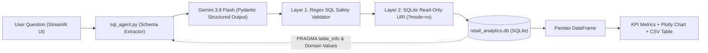

# Text-to-SQL Business Analytics Copilot

An interactive, production-ready AI analytics copilot for startup founders and operators. Ask plain-English business questions and get transparent, read-only SQL queries, KPI metrics, interactive Plotly visualizations, and downloadable CSV tables powered by **Gemini 3.8 Flash** (`google-genai`), **Streamlit**, **SQLite**, **Pandas**, and **Plotly**.

---

## Architecture



### Repository Structure

```text
.
├── app.py              # Streamlit UI, query pipeline, KPIs & Plotly visualization engine
├── db_setup.py         # Relational schema creation & ~500-order retail dataset seeder
├── sql_agent.py        # Schema extraction, Gemini structured outputs & SQL safety validator
├── requirements.txt    # Pinned Python dependencies
├── .env.example        # Environment variable template for GEMINI_API_KEY
└── README.md           # Documentation & deployment guide
```

---

## Database Schema

`db_setup.py` automatically creates and seeds `retail_analytics.db` on first app startup (zero-config for local runs and Streamlit Community Cloud):

- **`sales_reps`**: Sales representatives across regions with monthly quotas.
- **`customers`**: 80 B2B/retail customer accounts across segments (`Enterprise`, `Mid-Market`, `SMB`, `Startup`) and regions (`Metro Manila`, `Cebu`, `Davao`, `Luzon`, `Visayas`).
- **`products`**: 20 products across `Electronics`, `Office Gear`, `Software Licenses`, and `Accessories` with unit prices and costs.
- **`orders`**: ~500 multi-month retail orders spanning 12 months with statuses (`Completed`, `Returned`, `Pending`) and shipping fees.
- **`order_details`**: Line items with quantities, unit prices, discounts (`discount_pct`), and pre-computed net revenue (`line_total`).

---

## Defense-in-Depth SQL Safety Guardrails

To ensure LLM-generated queries can never mutate or corrupt data, two independent safety layers are enforced in `sql_agent.py`:

1. **Strict Regex & Prefix Validation (`validate_sql_query`)**:
   - Rejects any query that does not begin with `SELECT` or `WITH`.
   - Blocks SQL comments (`--`, `/* */`) and multi-statement separators (`;`).
   - Rejects dangerous keywords (`DROP`, `DELETE`, `UPDATE`, `INSERT`, `ALTER`, `ATTACH`, `DETACH`, `PRAGMA`, `EXEC`, `CREATE`, `REPLACE`, `TRUNCATE`, `VACUUM`, etc.).
2. **SQLite Read-Only URI Mode (`?mode=ro`)**:
   - Every analytics query executes over a connection opened with `sqlite3.connect("file:.../retail_analytics.db?mode=ro", uri=True)`, enforcing read-only access at the database engine level.

---

## Local Setup

1. **Create and activate a virtual environment**:
   ```bash
   python -m venv .venv
   # Windows (PowerShell)
   .venv\Scripts\Activate.ps1
   # macOS / Linux
   source .venv/bin/activate
   ```

2. **Install dependencies**:
   ```bash
   pip install -r requirements.txt
   ```

3. **Configure your Gemini API key** (optional — you can also enter it directly in the sidebar):
   ```bash
   cp .env.example .env
   # Edit .env and set GEMINI_API_KEY=your_actual_key
   ```

4. **Run the Streamlit app**:
   ```bash
   streamlit run app.py
   ```
   `retail_analytics.db` will be generated and seeded automatically on first launch. To re-seed manually at any time:
   ```bash
   python db_setup.py --force
   ```

---

## Deploying to Streamlit Community Cloud

1. Push this repository to GitHub.
2. Create a new app on [Streamlit Community Cloud](https://share.streamlit.io/) pointing to `app.py`.
3. *(Optional)* Add `GEMINI_API_KEY = "your_key"` under **App Settings → Secrets**, or leave it unset so reviewers can paste their own key into the password-masked sidebar input.

---

## Sample Business Questions

- *"Which product category generated the highest net revenue?"*
- *"Show monthly revenue trends over the past year"*
- *"Top 5 customers by total spend"*
- *"Which region has the highest return rate?"*
- *"Compare sales rep performance by total completed orders"*
- *"What is the gross profit margin by product category for completed orders?"*
- *"Which customer segment receives the highest average discount?"*
